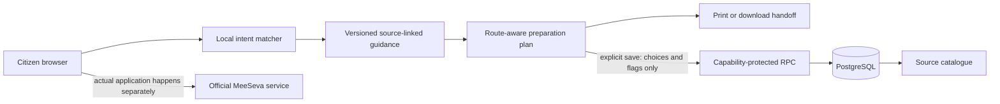

# SevaPath

**A clearer path to Telangana public services.**

An ESD Innovation Challenge 2026 build: a source-linked Telugu/English companion that helps citizens prepare for an income-certificate application before they open MeeSeva or visit a centre.

**Submission link:** https://github.com/rayanakarthikeyan/sevapath-esd

## Judge's quick start

1. Open the public demo: **https://rayanakarthikeyan.github.io/sevapath-esd/**.
2. Select **No payslip?** and see source-linked alternatives. Try **College scholarship** to see the exact-service confirmation prompt.
3. Open **My preparation**, select **MeeSeva centre**, and observe the additional application-form item. Switch to **Citizen login** and compare.
4. Check items, save to the cloud, change an item locally, then restore the cloud copy. The progress indicator is preparation only, never government application status.
5. Switch to Telugu, try larger text, inspect sources, download/print the plan, and delete your test preparation.

If hosting is unavailable, run locally using the steps below. The cloud requires Internet; discovery, guidance, checklists and file metadata checks run in the browser after loading. This is not a fully offline-installable PWA.

## The problem

A citizen understands their situation but may not understand the service vocabulary or which supporting evidence to bring. Telangana's **published** mobile-governance FAQ describes applications that must be finished in one sitting and advises advance document preparation. The income form offers identity and income-proof alternatives and specifically exempts citizen login from the paper application requirement.

These are concrete opportunities for a preparation layer. They are evidence from published materials, **not a claim that the current live portal has been audited, that the FAQ is current, or that abandonment rates have been measured**. See [problem evidence](docs/PROBLEM-EVIDENCE.md).

## What works

- English, Telugu-script and selected Romanized Telugu intent matching, with ambiguity handling. This is a small, local TF-IDF prototype classifier, not an LLM or a general-purpose chatbot.
- One complete guided flow: **general income-certificate preparation**. Three other service categories link to an official directory; they do not claim full workflows.
- Route-aware document checklist, income-proof alternatives and scholarship/service-purpose caution.
- Self-declared readiness, larger text, semantic controls, keyboard focus, optional browser read aloud, responsive layout, print and text export.
- Local PDF/JPEG metadata checks against published reference limits; no content, OCR or authenticity verification.
- Real PostgreSQL database, migrations, foreign keys, anonymous capability-protected CRUD RPC, source catalogue and optional feedback.
- Automatic device copy and explicit cloud save/restore/delete. Neither query text nor document contents is uploaded to our database.

There is no government submission, payment, eligibility decision, certificate issuance, identity verification, live status, SMS or official government API integration. SevaPath is an independent prototype and uses no government branding or seals.

## Technology and architecture

Vanilla JavaScript + Vite; `@insforge/sdk`; InsForge PostgreSQL and PostgREST RPC. No paid AI inference or remote model is required. The local model uses Unicode tokenization, a curated multilingual corpus, TF-IDF vectors and cosine similarity. Document guidance is authored from cited sources and cannot be generated by the model.



## Install and run

Requirements: Node.js **20.19+** or 22+, npm, a modern browser, and an InsForge backend for cloud features.

```sh
git clone https://github.com/rayanakarthikeyan/sevapath-esd.git
cd sevapath-esd
npm ci
```

Copy `.env.example` to `.env.local`, then set:

```text
VITE_INSFORGE_URL=<your real linked project URL>
VITE_INSFORGE_ANON_KEY=<your project's public anonymous key>
```

Retrieve these from your own InsForge linked project. **Never use the admin API key in a VITE variable.** Without these variables the app still runs in clearly labelled device mode; cloud buttons report that configuration is missing.

```sh
npm run dev
# Open the printed Local URL, normally http://127.0.0.1:5173
npm test
npm run build
npm run preview
```

## Database setup

The submitted demo uses an implemented cloud schema, not a simulated browser database. To recreate it in your own project:

```sh
npx -y @insforge/cli login
npx -y @insforge/cli link
npx -y @insforge/cli db migrations up --all
npm run test:cloud
```

Link only to a new/test backend you intend to use for this app. The migration creates `service_sources`, `preparation_drafts`, `preparation_feedback` and `sevapath_draft`. The source catalogue is seeded by the migration; test drafts are created and removed by the integration suite. See [database design and queries](docs/DATABASE.md) and [API documentation](docs/API.md).

## Repository structure

```text
src/                    UI, bilingual content, model, readiness rules, SDK API client
migrations/             PostgreSQL schema, constraints, source seed, access control
tests/                  Local behavior and intent regression tests
scripts/                Cloud integration test and artifact generation
docs/                   Evidence, API, database, testing, feasibility and demo guide
docs/evidence/          Actual machine-readable test results and screenshots
submission/             Submission brief and judge-facing checklist
.github/workflows/      CI and public demo deployment
.openai/hosting.json     Private companion-preview hosting manifest
```

## Testing and limitations

The local suite checks classification, ambiguous requests, route-specific readiness, input length, file limits and privacy field filtering. The cloud suite tests actual CRUD, alternate-capability isolation, denied direct access, invalid inputs, feedback and deletion. See [actual results and known issues](docs/TESTING.md); no user-study results are fabricated.

An anonymous random 256-bit device capability is a bearer secret. Only its SHA-256 hash is stored. Losing browser storage loses access to that draft; a shared browser profile shares the capability. Direct anonymous reads and writes to draft tables are revoked, with RLS enabled. Production needs abuse throttling, expiry/retention automation, independent accessibility/security review, source-owner review and a representative multilingual evaluation. This prototype is not a certified government deployment. See [privacy and threat model](docs/PRIVACY.md).

## Submission contents

- [Build submission checklist](submission/BUILD-CHECKLIST.md)
- [Submission brief PDF](submission/SevaPath-Submission-Brief.pdf)
- [Problem evidence](docs/PROBLEM-EVIDENCE.md)
- [API](docs/API.md), [database](docs/DATABASE.md), [testing](docs/TESTING.md)
- [Demo script and judge Q&A](docs/DEMO.md)
- [Pilot plan and feasibility](docs/PILOT.md)

No earlier approved Design-stage artifact was supplied. The design rationale and scope are documented here; prior-design conformance is not claimed. The attached Build-stage guidelines govern this pack. Final Demo-stage guidelines were not attached, so their additional requirements remain to be checked.

Author/committer email: **rayanakarthikeyan@gmail.com**. Independent competition prototype; no promise of competition outcome.
